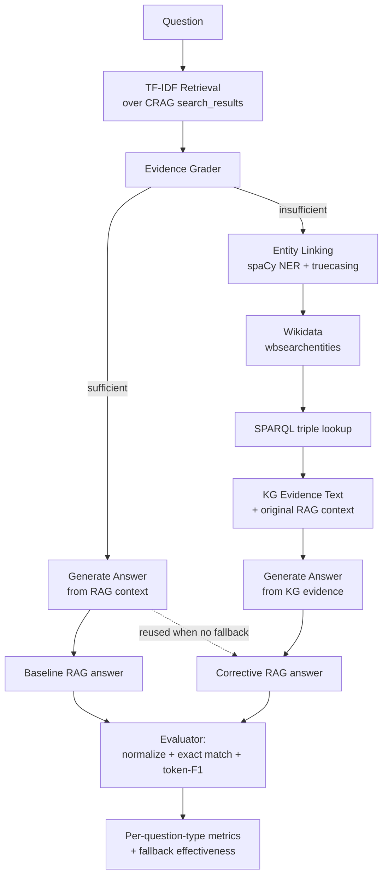

# P3 – Corrective RAG with Knowledge-Graph Fallback

**Course:** Knowledge Graph and Information Retrieval Systems (KGIRS)

**Problem statement:** On 200 questions from the CRAG benchmark, build the same evaluator with a KG-lookup fallback. Compare fallback rate and accuracy by question type.

---

## 1. What this project is

Two question-answering systems are built over the same 200 CRAG questions and compared:

- **System A – Baseline RAG**: retrieve evidence → build context → generate an answer.
- **System B – Corrective RAG**: retrieve evidence → **grade** whether it is good enough → if yes, answer normally; if no, fall back to a **live Wikidata Knowledge-Graph lookup** and answer from the retrieved facts.

The project measures whether the KG fallback actually helps: overall accuracy, fallback rate, and accuracy broken down by CRAG's 8 official question types (and, as an extra cut, by CRAG's static/fast-changing/real-time "dynamism" label).

### What is Corrective RAG?

Plain RAG trusts whatever the retriever returns, even when it's irrelevant or missing the entity the question is about — the generator then either hallucinates or answers from noise. **Corrective RAG** adds an explicit *evidence-quality* checkpoint between retrieval and generation: if the retrieved evidence looks insufficient, the system does not trust it blindly — it corrects course by pulling evidence from an independent source before answering.

### Why a Knowledge-Graph fallback?

A web search retriever is good at loosely-relevant unstructured text but can miss precise factual relationships, especially when the question is about a specific entity attribute (a founder, a director, a capital). A Knowledge Graph (Wikidata) stores exactly that kind of fact as structured `(entity, property, value)` triples — when RAG evidence is thin, a direct KG lookup can supply a precise fact RAG's noisy web snippets didn't surface.

---

## 2. Architecture



Answer generation itself is a pluggable backend (`src/generation/answer_generator.py`):
- **Groq LLM** (OpenAI-compatible API) when `GROQ_API_KEY` is set — prompted to answer strictly from the supplied evidence, concisely, and to say "I don't know" rather than hallucinate.
- **Local extractive fallback** (default, no API key needed) — picks the evidence sentence/fact most TF-IDF-similar to the question. Fully deterministic and offline.

---

## 3. Dataset: CRAG benchmark, 200-question sampling

- **Source**: the official CRAG (KDD Cup 2024, Meta) benchmark, mirrored at Hugging Face [`Quivr/CRAG`](https://huggingface.co/datasets/Quivr/CRAG), `crag_task_1_and_2` config (`subset/crag_task_1_and_2/*.jsonl.bz2`). Two subset files (`crag_subset_1.jsonl.bz2`, `crag_subset_2.jsonl.bz2`, 272 questions total) were downloaded into `data/raw/`.
- **Schema used as-is** (no invented fields): `interaction_id`, `query`, `answer`, `question_type`, `domain`, `static_or_dynamic`, `query_time`, and `search_results` (5 web passages per question: title, URL, snippet, full HTML page). The raw page HTML is stripped to plain text (`src/data/html_utils.py`) and capped at 4000 characters per passage.
- **Question types used directly from CRAG** (not invented): `simple`, `simple_w_condition`, `multi-hop`, `comparison`, `aggregation`, `set`, `false_premise`, `post-processing`. This is CRAG's own official taxonomy — the most academically meaningful categorisation available, so no custom classifier was built.
- **Sampling** (`scripts/prepare_dataset.py`): **stratified by `question_type`**, proportional to each type's share of the combined 272-question raw pool, using the *largest-remainder method* so the 200-question allocation sums exactly and stays proportional. Fixed `random.Random(seed=42)` shuffles within each type before truncation, so **re-running the script selects the identical 200 questions** (verified by `tests/test_dataset_sampling.py`).
- **Saved subset**: `data/processed/eval_subset_200.jsonl` — every evaluation run reads this fixed file, never re-samples from raw data.

Resulting 200-question allocation:

| question_type | count |
|---|---|
| simple | 57 |
| simple_w_condition | 29 |
| aggregation | 23 |
| comparison | 23 |
| false_premise | 23 |
| set | 18 |
| multi-hop | 18 |
| post-processing | 9 |

Domain spread: finance 46, sports 45, movie 44, open 43, music 22. Dynamism spread: static 113, slow-changing 47, fast-changing 23, real-time 17.

---

## 4. Baseline RAG method

`src/retrieval/tfidf_retriever.py` ranks CRAG's own 5 provided web passages per question with **TF-IDF cosine similarity** (`scikit-learn`) between the question and each passage's title+snippet+body text, returning the top-`k` (default `k=3`). This respects CRAG's existing retrieval structure rather than building an unrelated external corpus, per the project brief. Retrieval is fully local and deterministic — no embeddings download, no network call — which makes it easy to explain and to swap out later.

The baseline's evidence (titles + snippets) is handed to the answer generator unmodified.

---

## 5. Corrective / fallback decision logic

`src/corrective/evidence_grader.py` computes two signals, **no LLM call, fully deterministic**:

1. **`retrieval_score`** — the top-1 TF-IDF cosine similarity. Below `fallback_similarity_threshold` (0.12) ⇒ `low_retrieval_relevance`.
2. **`entity_coverage`** — fraction of the question's key entities (spaCy NER, with a truecasing pre-pass since CRAG questions are lowercase and a noun-chunk fallback) that are actually mentioned in the retrieved passages (full-phrase or ≥50%-of-words partial match). Below `fallback_entity_coverage_threshold` (0.5) ⇒ `missing_required_entity`.
3. Zero passages retrieved at all ⇒ `no_evidence_retrieved`.

Any one of these reasons firing sets `fallback_triggered = True`; **all** firing reasons are recorded (not just the first), so every question's trace shows exactly why it fell back. This keeps the decision inspectable for a viva instead of hiding it behind an opaque model call. Thresholds were picked by inspection of a handful of example questions, not tuned against the 200-question test answers (no data leakage).

---

## 6. Knowledge-Graph integration

A **real structured KG access path** — not a disguised LLM call:

1. **Entity linking** (`src/knowledge_graph/entity_linker.py`): candidate entity mentions come from spaCy NER/noun-chunks on the (truecased) question; each mention is resolved to a Wikidata QID via the `wbsearchentities` API; when multiple candidates share a name, the one whose Wikidata description shares the most keywords with the question is preferred (a lightweight disambiguation heuristic, not hardcoded per question).
2. **Triple retrieval** (`src/knowledge_graph/wikidata_client.py`): a **SPARQL query** against `https://query.wikidata.org/sparql` pulls every direct claim of the resolved QID as a labelled `(property, value)` pair.
3. **Relevance ranking**: triples are ranked by lexical overlap with the question's keywords so the most question-relevant facts come first.
4. **Evidence construction**: the top facts become `(entity, property, value)` lines fed to the generator, optionally alongside the original RAG context.
5. **Caching**: every successful Wikidata response (search + triples + labels) is cached to `data/cache/wikidata_cache.json`, keyed by request, so repeated evaluation runs are fast and don't re-hit the network.
6. **No fabrication**: if no entity resolves, or a resolved entity has no triples, `KGResult.found = False` and the pipeline records that explicitly rather than inventing facts.

---

## 7. Evaluation methodology

- **Normalisation** (`src/evaluation/normalize.py`): lowercase, strip punctuation, collapse whitespace, drop articles (a/an/the).
- **Deterministic metrics** (`src/evaluation/metrics.py`):
  - `exact_match` — normalised strings identical.
  - `token_f1` — SQuAD-style token-level F1 (handles legitimate surface-form differences, e.g. "4" vs "four attempts per game").
  - `correct = exact_match OR token_f1 ≥ 0.5 OR normalised gold is a substring of normalised prediction`. This last clause specifically matters for CRAG's `false_premise` questions, whose gold answer is the short phrase `"invalid question"`.
- Both metrics are reported; `correct` is the single deterministic pass/fail used for all accuracy figures. **No LLM judge is used** — the brief requires at least one deterministic metric, and given CRAG's short-answer format, exact-match+F1 alone was judged sufficient (academically defensible; an LLM judge is listed as a future improvement).
- Ground truth is never shown to the generator — `generate_answer` only ever receives the question and retrieved/KG evidence.

Every one of the 200 questions produces one record in `results/predictions/predictions.jsonl` with: question id/text/type/domain, ground truth, baseline + corrective answers, retrieved titles/scores/context, fallback flag + reasons, entity coverage + missing entities, KG entities/QIDs/triples, and both correctness verdicts.

---

## 8. Metrics computed

`src/evaluation/aggregate.py` / `scripts/analyse_results.py` produce:

- Overall baseline accuracy, corrective accuracy, absolute/relative improvement
- Total KG fallback count and rate
- Accuracy when fallback triggered vs not triggered; fallback success rate
- Baseline-wrong→Corrective-correct count (the "fallback actually helped" case), and the reverse (fallback hurt)
- Confusion-style 2×2 breakdown (baseline×corrective correctness)
- Per-question-type: count, baseline accuracy, corrective accuracy, fallback count/rate, accuracy gain
- Per-domain and per-dynamism (static/slow/fast/real-time) breakdowns — the latter specifically surfaces that a largely-static KG cannot help with fast-changing/real-time facts (see Results below)

---

## 9. Installation

```bash
cd Project
pip install -r requirements.txt
python -m spacy download en_core_web_sm
```

## 10. Environment variables

Copy `.env.example` to `.env` and fill in real values (`.env` is never read by anything except this project, and should never be committed):

```
GROQ_API_KEY=            # get one free at https://console.groq.com/keys
GROQ_MODEL=llama-3.3-70b-versatile
GROQ_API_BASE=https://api.groq.com/openai/v1
WIKIDATA_SPARQL_ENDPOINT=https://query.wikidata.org/sparql
WIKIDATA_API_ENDPOINT=https://www.wikidata.org/w/api.php
WIKIDATA_USER_AGENT=CorrectiveRAG-CollegeProject/1.0 (contact: you@example.com)
```

If `GROQ_API_KEY` is left blank, the pipeline automatically uses the local extractive generator — nothing breaks, nothing needs a code change.

## 11. How to run the 200-question experiment

```bash
python scripts/prepare_dataset.py     # builds data/processed/eval_subset_200.jsonl (only needed once / to re-sample)
python scripts/run_evaluation.py      # runs both systems on all 200 questions -> results/predictions/
python scripts/analyse_results.py     # computes metrics + charts -> results/metrics/, results/plots/
```

Re-running `run_evaluation.py` re-evaluates the exact same 200 questions (fixed subset file, fixed pipeline, fixed seed) — only the generated *answers* can change if you add/change `GROQ_API_KEY` between runs.

## 12. How to run the Streamlit demo

```bash
streamlit run app.py
```

Two tabs: **"Try a question"** (live pipeline trace on any typed question — retrieval, fallback decision, KG entity linking, KG facts, both answers) and **"Evaluation results"** (the saved 200-question metrics, charts, and representative improved/worsened examples).

---

## 13. Results (local extractive generator, `GROQ_API_KEY` unset)

These are the actual numbers from the 200-question run checked into `results/`. **They reflect the no-LLM local extractive answer generator** (CRAG's questions — especially `aggregation`, `comparison`, `set` — often require arithmetic/reasoning over evidence that pure sentence-extraction cannot do). Re-run `scripts/run_evaluation.py` after adding a `GROQ_API_KEY` to get a stronger, LLM-generated comparison; the pipeline, grading logic, and KG integration do not change, only the generation backend.

| Metric | Value |
|---|---|
| Baseline RAG accuracy | 6.0% |
| Corrective RAG accuracy | 6.0% |
| Absolute improvement | +0.0 pp |
| Total KG fallback count | 17 / 200 |
| KG fallback rate | 8.5% |
| Accuracy when fallback triggered | 0.0% |
| Accuracy when fallback not triggered | 6.6% |
| Fallback success rate | 0.0% |
| Baseline-wrong → Corrective-correct | 0 |
| Baseline-correct → Corrective-wrong | 0 |

Per-question-type (see `results/metrics/per_question_type_metrics.csv` for the full table):

| question_type | n | baseline acc | corrective acc | fallback rate |
|---|---|---|---|---|
| comparison | 23 | 21.7% | 21.7% | 0.0% |
| post-processing | 9 | 11.1% | 11.1% | 0.0% |
| simple_w_condition | 29 | 6.9% | 6.9% | 10.3% |
| multi-hop | 18 | 5.6% | 5.6% | 11.1% |
| simple | 57 | 5.3% | 5.3% | 15.8% |
| aggregation | 23 | 0.0% | 0.0% | 0.0% |
| false_premise | 23 | 0.0% | 0.0% | 13.0% |
| set | 18 | 0.0% | 0.0% | 0.0% |

Per-dynamism (`results/metrics/per_dynamism_metrics.csv`) — the key qualitative finding:

| dynamism | n | fallback rate | accuracy when fallback triggered |
|---|---|---|---|
| real-time | 17 | 35.3% | 0.0% |
| static | 113 | 7.1% | 0.0% |
| slow-changing | 47 | 4.3% | 0.0% |
| fast-changing | 23 | 4.3% | 0.0% |

**Interpretation**: with this local, no-LLM generator, the fallback never improved an answer in this run. Two separate causes are visible in the per-question traces (`results/predictions/predictions.jsonl`):
1. **Generation weakness, not retrieval/KG weakness** — the extractive generator returns a full evidence sentence/triple rather than a precise short value, which rarely exact/F1-matches CRAG's terse gold answers (e.g. for a date or stock price). This is the dominant failure mode and is expected to improve substantially with the Groq LLM backend.
2. **A genuine, structural KG limitation** — `real-time` questions (live stock prices, same-week dividends) trigger fallback *most often* (35%) precisely because RAG evidence for them is sparse/noisy, but Wikidata (a largely static encyclopedic snapshot) **cannot** answer them either. This is a legitimate, reportable limitation of KG fallback, not a bug — see Limitations below.

---

## 14. Project structure

```
Project/
    app.py                         # Streamlit demo
    README.md
    requirements.txt
    .env.example

    src/
        config.py                  # all tunable parameters in one place
        data/                      # schema, raw-file loader, HTML stripping
        retrieval/                 # TF-IDF retriever
        corrective/                # evidence grader + end-to-end pipeline
        knowledge_graph/           # Wikidata client, entity linker, KG fallback
        generation/                # Groq LLM client + local extractive generator
        evaluation/                # normalisation, metrics, aggregation
        utils/                     # shared entity/keyword extraction

    data/
        raw/                       # downloaded CRAG subset .jsonl.bz2 files
        processed/                 # fixed 200-question eval_subset_200.jsonl
        cache/                     # wikidata_cache.json

    results/
        predictions/               # predictions.jsonl (full trace) + .csv
        metrics/                   # overall/confusion/per-type/per-domain/per-dynamism CSVs + summary.json
        plots/                     # 5 PNG charts

    scripts/
        prepare_dataset.py
        run_evaluation.py
        analyse_results.py
        smoke_test.py               # quick manual trace on a few questions

    tests/                          # 30 unit tests (normalisation, metrics, grading, KG, sampling, aggregation)
```

---

## 15. Limitations

- **No-LLM baseline accuracy is low.** The local extractive generator is a deliberate, API-key-free default; it struggles on CRAG's `aggregation`/`set`/multi-step questions that require computation rather than extraction. Adding `GROQ_API_KEY` is expected to raise both systems' accuracy substantially without any pipeline changes.
- **Entity linking is not research-grade.** It is literal `wbsearchentities` + keyword-overlap disambiguation — it can resolve a mention to the wrong same-named entity (observed e.g. on ambiguous person names) or latch onto a generic concept (e.g. "zoo" the animal park instead of the film *We Bought a Zoo*). A real entity-linking model (e.g. a trained NED system) would improve this.
- **Wikidata is static/encyclopedic.** It structurally cannot answer `real-time`/`fast-changing` factual questions (live stock prices, this-week sports results) — visible directly in the per-dynamism table above. The fallback is most valuable for stable factual relationships (founders, directors, capitals), not fast-moving data.
- **No false-premise detection.** `false_premise` questions (gold answer `"invalid question"`) are answered like any other question; the system never learns to recognise and reject a false premise. This is a natural next step (see below).
- **Correctness metric is lenient but not perfect.** `token_f1 ≥ 0.5` can occasionally over- or under-credit longer free-form answers (e.g. `comparison`/`set` questions with multi-part gold answers); an LLM-judge pass would sharpen this at the cost of determinism.
- **Fixed retrieval top-k=3 and single-pass fallback** (no iterative re-grading after the KG lookup).

## 16. Potential future improvements

- Enable `GROQ_API_KEY` and re-run for an LLM-generation comparison.
- Add an LLM-based evidence grader/judge as a second, clearly-labelled metric alongside the deterministic one.
- Train or fine-tune a lightweight entity-linking/disambiguation model instead of the keyword-overlap heuristic.
- Add explicit false-premise detection (e.g. a contradiction check between the question's presupposition and retrieved/KG evidence) so `false_premise` questions can be answered `"invalid question"` directly.
- Extend the KG layer to a second knowledge base (e.g. a finance-specific KG) for domains like `finance` where Wikidata coverage of fast-changing data is intrinsically weak.
- Calibrate `fallback_similarity_threshold` / `fallback_entity_coverage_threshold` via a held-out validation split instead of manual inspection.
